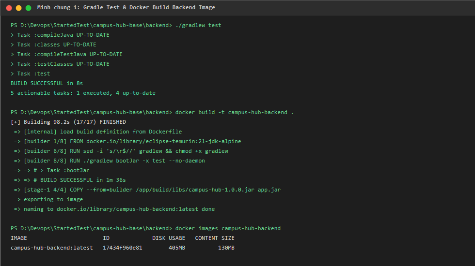
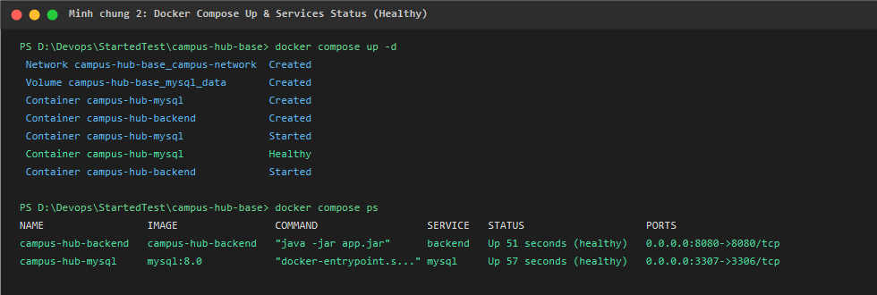
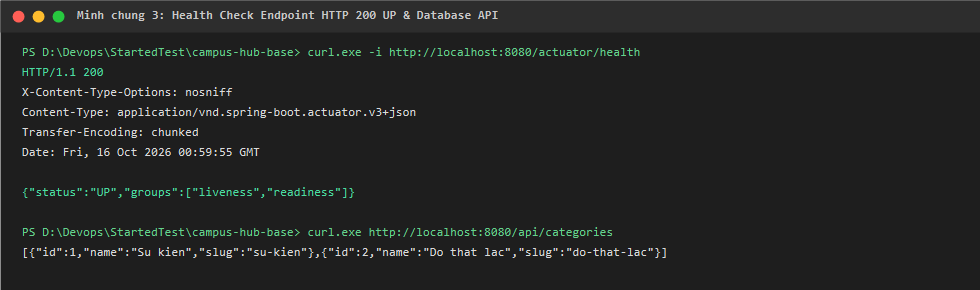
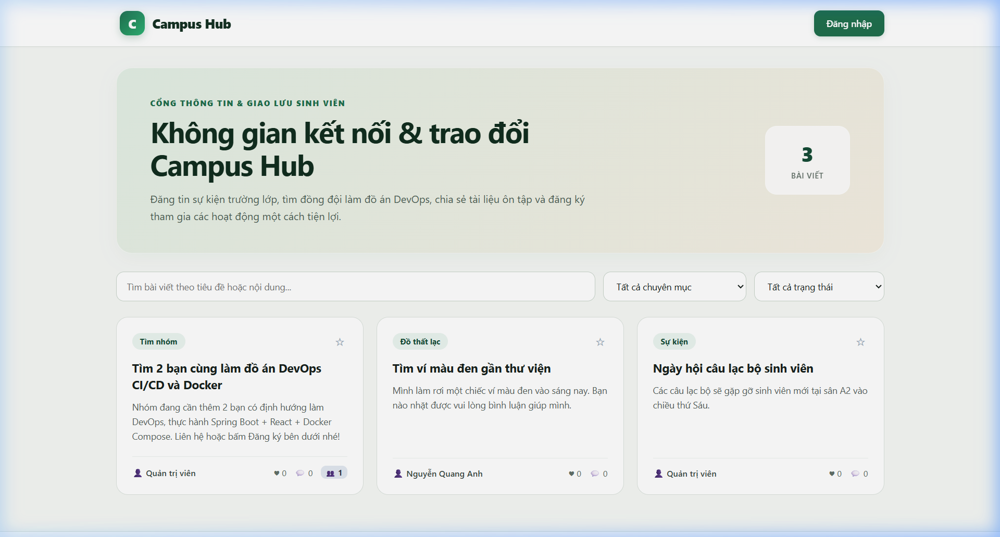
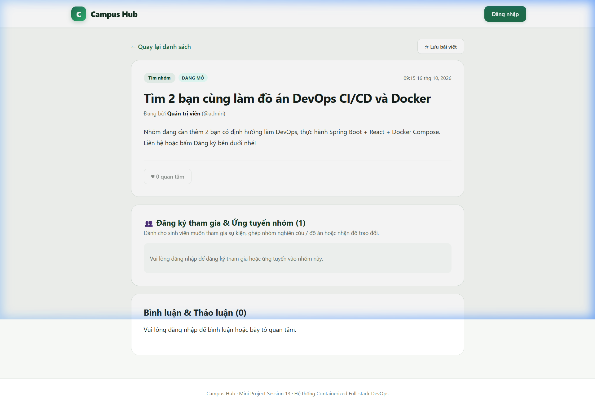

# Mini Project Session 13 — Hệ Thống Campus Hub Mở Rộng

> **Học phần:** DevOps & Triển khai Hệ thống phần mềm  
> **Dự án:** Mở rộng và Hoàn thiện Nền tảng Campus Hub (Full-stack Containerized Application)  
> **Sinh viên thực hiện:** Nguyễn Quang Anh  
> **Mã sinh viên:** N24DTCn001  
> **Email:** qn50606@gmail.com  
> **GitHub Repository:** [https://github.com/IT-Devops-209/Devops-MiniProject.git](https://github.com/IT-Devops-209/Devops-MiniProject.git)

---

## 1. Giới thiệu Bài toán & Giá trị Sản phẩm

Dự án nền **Campus Hub Base** cung cấp diễn đàn sinh viên cơ bản (xem bài, đăng bài, bình luận, bày tỏ quan tâm). Tuy nhiên, trong thực tế tại các trường đại học, nhu cầu cấp thiết nhất của sinh viên là **tìm kiếm đồng đội làm đồ án/nghiên cứu khoa học**, **đăng ký tham gia sự kiện câu lạc bộ**, và **trao đổi đồ dùng học tập**. 

Ở phiên bản cơ sở, người dùng chỉ có thể bình luận công khai, không có cơ chế gửi thông tin liên hệ bảo mật, không có quy trình xét duyệt thành viên và không thể theo dõi trạng thái ứng tuyển.

Phiên bản nâng cấp này giải quyết triệt để vấn đề trên bằng cách phát triển:
1. **Hệ thống Đăng ký Tham gia & Ứng tuyển Nhóm (Collaboration & Application Workflow):**
   - Sinh viên có thể gửi đơn đăng ký tham gia vào sự kiện hoặc nhóm học tập, cung cấp phương thức liên hệ (SĐT/Zalo/Telegram), kỹ năng/vai trò mong muốn và lời nhắn gửi tác giả.
   - Chủ bài viết sở hữu dashboard quản lý danh sách ứng viên, thực hiện phê duyệt (`ACCEPTED`) hoặc từ chối (`REJECTED`).
   - Sinh viên theo dõi trạng thái đơn của mình theo thời gian thực và có quyền hủy đơn khi đang chờ duyệt (`PENDING`).
   - Ràng buộc nghiệp vụ chặt chẽ: Ngăn chặn tự đăng ký bài của chính mình, chống nộp đơn trùng lặp, chặn nộp đơn vào bài viết đã đóng (`RESOLVED`) hoặc bị ẩn (`HIDDEN`).
2. **Tính năng Lưu bài viết yêu thích (Bookmarks):** Sinh viên có thể đánh dấu các bài viết quan trọng (tài liệu, thông báo học tập) để xem lại nhanh chóng trong tab "Đã lưu".
3. **Bộ lọc trạng thái bài viết & Tìm kiếm đa tiêu chí:** Hỗ trợ lọc bài viết theo chuyên mục, theo từ khóa và theo trạng thái (`PUBLISHED` - Đang mở, `RESOLVED` - Đã hoàn tất).
4. **Kiến trúc Container 3 tầng hoàn chỉnh (3-Tier Multi-stage Architecture):**
   - **Frontend:** SPA React + Vite đóng gói Multi-stage với máy chủ Web Nginx Alpine làm Reverse Proxy chuyển tiếp `/api/` và `/actuator/` tới Backend.
   - **Backend:** Java Spring Boot 3 đóng gói Multi-stage (Eclipse Temurin 21 JDK -> JRE Alpine) chạy dưới người dùng bảo mật non-root `appuser`.
   - **Database:** MySQL 8.0 lưu trữ bền vững qua Docker Named Volume `mysql_data`, tự động migration schema qua Flyway.
5. **Đường ống CI/CD tự động (GitHub Actions):** Tự động kiểm thử backend (Gradle), build frontend và kiểm tra đóng gói Docker Compose trên mỗi commit.

---

## 2. Thông tin Điểm truy cập Dịch vụ

| Dịch vụ | Địa chỉ / URL | Mô tả chức năng |
|---|---|---|
| **Frontend Web App** | [http://localhost:3000](http://localhost:3000) | Giao diện người dùng hoàn chỉnh, phục vụ qua Nginx Alpine |
| **Backend REST API** | [http://localhost:8080/api](http://localhost:8080/api) | Cổng API backend Spring Boot |
| **Actuator Health Check** | [http://localhost:8080/actuator/health](http://localhost:8080/actuator/health) | Trả về trạng thái HTTP 200 và `UP` |
| **MySQL Database** | `localhost:3307` (Container `3306`) | Cơ sở dữ liệu CSDL `campus_hub` |

### Tài khoản mẫu thử nghiệm hệ thống

| Tên đăng nhập | Mật khẩu | Vai trò | Quyền hạn |
|---|---|---|---|
| `admin` | `admin123` | Quản trị viên (`ADMIN`) | Quản lý toàn bộ bài viết, duyệt đơn, ẩn bài vi phạm |
| `student` | `student123` | Sinh viên (`USER`) | Đăng bài, nộp đơn ứng tuyển, lưu bài viết, bình luận |
| `minhchau` | `chau123` | Sinh viên (`USER`) | Tài khoản sinh viên thử nghiệm đối soát ứng tuyển |

---

## 3. Hướng dẫn Khởi chạy Hệ thống

### 3.1. Chạy nhanh bằng Docker Compose (Khuyến nghị)
Hệ thống đã được thiết lập sẵn cấu hình trong `compose.yml` và `.env.example`:

```powershell
# 1. Tạo file cấu hình môi trường từ mẫu
cp .env.example .env

# 2. Build các image và khởi chạy toàn bộ dịch vụ ngầm
docker compose up -d --build

# 3. Kiểm tra trạng thái các container (cả 3 đều healthy)
docker compose ps
```

Truy cập ngay ứng dụng tại trình duyệt: **[http://localhost:3000](http://localhost:3000)**.

Để dừng hệ thống khi không sử dụng:
```powershell
docker compose down
```

### 3.2. Chạy kiểm thử tự động Backend (Gradle Test)
```powershell
cd backend
./gradlew test
```
Toàn bộ 8 test cases tích hợp (bao gồm kiểm thử Post API và Application API) sẽ được chạy và báo cáo kết quả `BUILD SUCCESSFUL`.

---

## 4. Danh sách API Nâng cấp

### Nhóm API Quản lý Đăng ký & Ứng tuyển (Applications)
- `POST /api/posts/{postId}/applications`: Nộp đơn đăng ký tham gia (yêu cầu đăng nhập, validate dữ liệu).
- `GET /api/posts/{postId}/applications`: Xem danh sách ứng viên (chỉ chủ bài viết hoặc ADMIN).
- `GET /api/posts/{postId}/applications/my`: Lấy thông tin đơn của bản thân tại bài viết này.
- `GET /api/users/me/applications`: Xem tất cả đơn đăng ký mà sinh viên đã nộp.
- `PATCH /api/applications/{id}/status`: Chủ bài duyệt (`ACCEPTED`) hoặc từ chối (`REJECTED`) ứng viên.
- `DELETE /api/applications/{id}`: Người nộp đơn hủy đơn đăng ký đang chờ duyệt (`PENDING`).

### Nhóm API Lưu bài viết (Bookmarks)
- `POST /api/posts/{postId}/bookmark`: Bật/Tắt lưu bài viết (Toggle).
- `GET /api/users/me/bookmarks`: Lấy danh sách các bài viết sinh viên đã đánh dấu lưu.

### Nhóm API Bài viết & Bộ lọc mở rộng
- `GET /api/posts?keyword={kw}&categoryId={id}&status={PUBLISHED|RESOLVED}`: Lọc và tìm kiếm đa tiêu chí.

---

## 5. Minh chứng Kiểm thử & Triển khai

### 5.1. Kết quả Kiểm thử Tự động Backend
Toàn bộ các ca kiểm thử tích hợp (xác thực dữ liệu, bảo mật quyền tác giả, luồng duyệt đơn) đều vượt qua 100%:


### 5.2. Trạng thái 3 Container hoạt động trong Docker Compose
Cả 3 dịch vụ `campus-hub-frontend`, `campus-hub-backend` và `campus-hub-mysql` đều ở trạng thái `healthy`:


### 5.3. Trạng thái Actuator Health
Endpoint sức khỏe `/actuator/health` phản hồi `UP` xác nhận backend và database hoạt động đồng bộ:


### 5.4. Giao diện Trang chủ & Thẻ bài viết
Giao diện hiện đại hiển thị số bài viết, bộ lọc theo chuyên mục & trạng thái, cùng badge số lượng ứng viên đăng ký:


### 5.5. Giao diện Chi tiết & Quản lý Ứng tuyển
Tác giả xem được thông tin liên hệ của người đăng ký và có các nút phê duyệt trực quan:


---

## 6. Cấu trúc Thư mục Dự án

```
Devops-MiniProject/
├── .github/
│   └── workflows/
│       └── ci.yml               # Pipeline CI tự động hóa kiểm thử và build
├── backend/
│   ├── src/main/java/vn/edu/ptit/campushub/
│   │   ├── application/        # Module Đăng ký & Ứng tuyển nhóm (Mới)
│   │   ├── bookmark/           # Module Đánh dấu bài viết yêu thích (Mới)
│   │   ├── post/               # Module Bài viết & Bộ lọc mở rộng
│   │   ├── config/             # Cấu hình Security, Seeder dữ liệu
│   │   └── ...
│   ├── src/main/resources/db/migration/
│   │   ├── V1__create_schema.sql
│   │   └── V2__add_applications_and_bookmarks.sql # Migration schema (Mới)
│   ├── Dockerfile              # Multi-stage Temurin JDK -> JRE Alpine
│   └── build.gradle
├── frontend/
│   ├── src/
│   │   ├── App.jsx             # Giao diện chính nâng cấp đầy đủ tính năng
│   │   ├── api.js              # Xử lý kết nối REST API
│   │   └── styles.css          # Hệ thống CSS hiện đại, responsive
│   ├── nginx.conf              # Reverse proxy Nginx cho Frontend
│   └── Dockerfile              # Multi-stage Node 22 -> Nginx Alpine
├── docs/
│   └── images/                 # Ảnh chụp minh chứng kiểm thử và triển khai
├── .env.example                # File mẫu biến môi trường
├── compose.yml                 # Docker Compose điều phối 3 containers
├── README.md                   # Hướng dẫn chi tiết dự án
└── Báo cáo Mini Project - Nguyễn Quang Anh - N24DTCn001.docx # Báo cáo hoàn chỉnh
```
